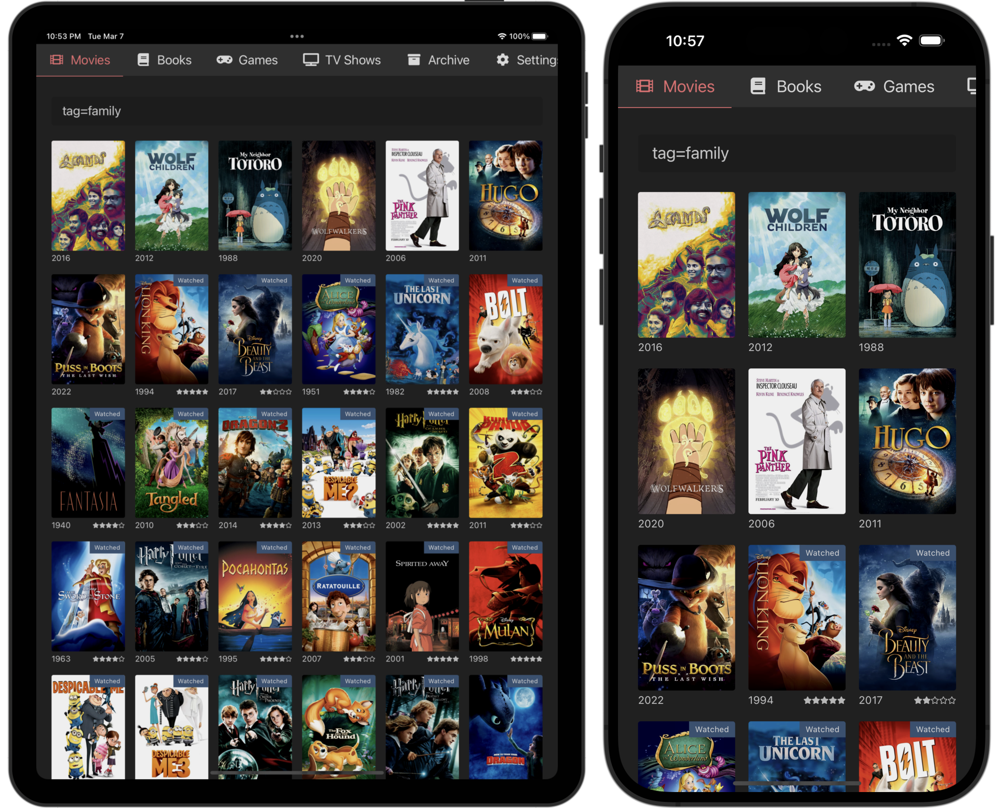

# Lists



App that keeps track of movies, TV shows, games, books and various other things.
This project exists because I'd rather manage these in one self-hosted location
instead of multiple third-party services, such as Letterboxd, Goodreads or the
Steam Library.

## Prerequisites

API:
   - [Ruby >= 2.6](https://www.ruby-lang.org/en/documentation/installation/)
   - [Bundler](https://bundler.io/)
   - [PostgreSQL >= 13](https://www.postgresql.org/)
   - [Redis](https://redis.io/)
   - [Imagemagick >= 7](https://www.imagemagick.org/script/index.php)

UI:
   - [Node >= 22](https://nodejs.org/en/)

Ensure that postgres and redis servers are running (listening to default ports).

## Installation

API (`cd api`):

   1. Install dependencies:
       ```bash
       bundle install
       ```

   2. Setup database:
       ```bash
       ./bin/rails db:setup
       ```

   3. Apply migrations:
       ```bash
       ./bin/rails db:migrate
       ```

UI (`cd ui`):

   1. Install dependencies:
      ```bash
      npm install
      ```

## Running

API (`cd api`):

```bash
brew services start postgresql@14
brew services start redis
./bin/rails server
```

UI (`cd ui`):

```bash
npm run dev
```

Then visit http://localhost:3001.

## Running tests

API (`cd api`):

```bash
./bin/rails test
```

UI (`cd ui`):

```bash
npm run test
```

## OPS

The top level directory contains some convenience scripts to help with deploying
and spawning remote shells.

- `deploy`: Builds and deploys backend and frontend to lists.rathr.io
- `redis`: Spawns a `redis-cli` in the redis container
- `postgres`: Spawns a `psql` shell in the postgres container
- `web`: Spawns a shell in the web container

## MCP server

The API exposes an [MCP](https://modelcontextprotocol.io) endpoint at
`/mcp` (`https://lists.rathr.io/api/mcp` in production) so that clients such as
Claude Desktop can search lists, read the journal, compute stats and check
Jellyfin availability on behalf of a user. It can also add items (looked up in
the list's catalog, e.g. TMDB, or entered by hand) and update their status,
rating, notes and recommendations. It can't archive or delete items.

Requests authenticate with a per-user bearer token. Generate one under
**Settings > API Token** in the web app (or with
`bin/rails 'api_token:generate[me@example.com]'`). Only its digest is stored, so
it's shown once; regenerating it revokes the old one.

### Claude Desktop

Claude Desktop talks to the remote endpoint through
[`mcp-remote`](https://github.com/geelen/mcp-remote), a small local bridge that
adds the token header. It needs Node.js (`node --version`).

1. Generate a token under **Settings > API Token** and copy it.
2. In Claude Desktop, open **Settings > Developer > Edit Config**. This opens
   `~/Library/Application Support/Claude/claude_desktop_config.json`
   (`%APPDATA%\Claude\claude_desktop_config.json` on Windows). Add a `lists`
   entry to `mcpServers`, keeping any other servers in there:

   ```json
   {
     "mcpServers": {
       "lists": {
         "command": "npx",
         "args": [
           "-y", "mcp-remote", "https://lists.rathr.io/api/mcp",
           "--header", "Authorization: Bearer ${LISTS_API_TOKEN}"
         ],
         "env": { "LISTS_API_TOKEN": "lists_..." }
       }
     }
   }
   ```

3. Quit Claude Desktop completely (Cmd+Q) and start it again.
4. Check that **lists** shows up under **+ > Connectors** in the chat input,
   then ask something like "What did I watch last month?" or "Recommend a movie
   from my watchlist I'd probably like". Claude asks for approval the first
   time it uses a tool.

Troubleshooting:

- Logs are in `~/Library/Logs/Claude/`: `mcp.log` for connection problems and
  `mcp-server-lists.log` for the bridge's output
  (`tail -f ~/Library/Logs/Claude/mcp*.log`).
- `spawn npx ENOENT`: Claude Desktop doesn't see your shell's `PATH`. Use the
  absolute path from `which npx` (e.g. `/opt/homebrew/bin/npx`) as `command`.
- `401`: the token is wrong or was regenerated. Generate a new one and update
  `LISTS_API_TOKEN`.
- Check the token outside Claude:

  ```sh
  curl https://lists.rathr.io/api/mcp \
    -H "Authorization: Bearer $LISTS_API_TOKEN" \
    -H 'Content-Type: application/json' \
    -H 'Accept: application/json, text/event-stream' \
    -d '{"jsonrpc":"2.0","id":1,"method":"tools/list"}'
  ```

For local development, point it at `http://localhost:3000/mcp` and add
`"--allow-http"` to `args`.

### Claude web and mobile

These connect from Anthropic's servers via a custom connector on your
claude.ai account, which then also shows up in the mobile apps. Custom
connectors expect OAuth, which Lists doesn't implement. Sending a fixed bearer
token through [request headers](https://claude.com/docs/connectors/custom/remote-mcp#authenticate-with-request-headers)
is in limited beta. If your account has it: **Customize > Connectors > Add
custom connector**, URL `https://lists.rathr.io/api/mcp`, authentication **No
sign-in**, and under **Request headers** add `authorization` with the value
`Bearer lists_...` (including `Bearer `).

## APIs used

Lists relies on the following APIs to scrape meta info:

- Movies / TV Shows: [The Movie DB](https://www.themoviedb.org)
   - https://developer.themoviedb.org/reference/intro/getting-started
- Video Games: [IGDB](https://www.igdb.com/discover)
- Books: [Google Books](https://developers.google.com/books)
- Recipes: [Edaman](https://www.edamam.com)
